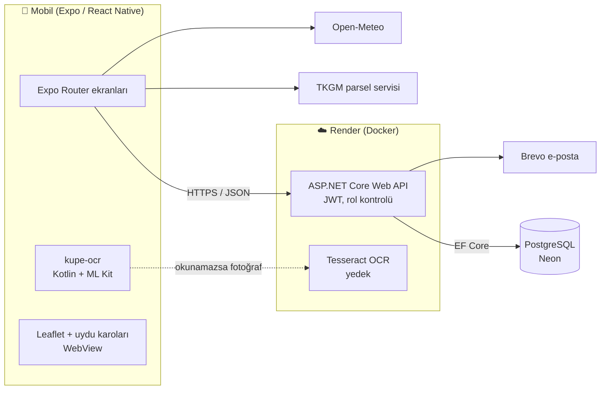

# Çiftliğim

**Tarım ve hayvancılık için çok kullanıcılı mobil uygulama** — sürü sahibi, yönetici ve çobanların aynı işletmenin kayıtlarını rollerine göre tuttuğu, küpe numarasını kamerayla okuyan, tarlaları tapu (TKGM) verisiyle haritada gösteren bir Android/iOS uygulaması.

Ailemizin çiftliğindeki gerçek bir ihtiyaçtan doğdu ve sahada kullanılıyor.

[English summary below ↓](#english)


---

## Özellikler

### Hayvancılık
- **Hayvan kartı:** tür, ırk, cinsiyet, doğum tarihi (tahmini olabilir), anne/baba, renk-işaret. Yaş saklanmaz, her sorguda doğum tarihinden hesaplanır.
- **Küpe okuma:** kamerayla küpe numarası telefonda, internetsiz okunur (ML Kit, ~1 sn). Okunan metin Türk küpe formatına (`TR` + il kodu + seri no) göre ayrıştırılır ve sürüdeki küpelerle benzerlik puanıyla eşleştirilir. Barkod/QR ve elle giriş de var.
- **Sağlık geçmişi:** ilaç, iğne, aşı, parazit, vitamin uygulamaları ve hastalıklar tek zaman çizelgesinde.
- **Arınma süresi:** ilaç kataloğundaki et/süt arınma süresinden "şu tarihe kadar kesilmez / sütü satılmaz" tarihi otomatik hesaplanır ve kayıt anında saklanır (katalog sonradan değişse de geçmiş bozulmaz).
- **Toplu işlem:** bütün sürüye aynı gün yapılan ilaç veya mera/ahır geçişi tek işlemle girilir.
- Tartım, konum (mera/ahır), yavrulama (yavrular istenirse otomatik hayvan olarak eklenir), çıkış (satıldı/öldü/kesildi/kayıp).
- Sürü listesini **Excel (CSV) veya PDF** olarak dışa aktarma.

### Tarım
- **Tarla kaydı:** il/ilçe/mahalle + ada/parsel ile TKGM'den sınır poligonu ve alan çekilir; uydu haritasında gösterilir. Haritada bir noktaya dokununca o koordinattaki parsel bulunur.
- Sahiplik (tam mülk, hisseli, kiracı, ortakçı), kira/ortakçılık sözleşmeleri.
- Yıllara göre ekim, verim ve **dekar başına verim** karşılaştırması; sürüm, gübre, ilaçlama, sulama, hasat işlemleri ve maliyetleri.
- Tarla koordinatına göre **hava durumu** ve don / yağış / rüzgâr uyarıları (Open-Meteo).

### Kullanıcılar ve yetki
| Rol | Görür | Kayıt ekler |
|---|---|---|
| Sahip | Her şeyi | Her şeyi; üye ekler, çoban atar |
| Yönetici | Her şeyi | Her şeyi (sahip ekleyemez) |
| Çoban | Yalnızca atandığı sürüler | Tedavi, tartım, konum, yavrulama — hayvan ekleyemez/silemez |
| İzleyici | Her şeyi | Hiçbir şey |

Her kaydın kim tarafından ve ne zaman girildiği saklanır. Üye olmayan kullanıcıya işletme için `404` döner (varlığı sızmaz).

---

## Mimari



| Katman | Teknoloji |
|---|---|
| Mobil | React Native, Expo SDK 58, Expo Router, TypeScript, expo-camera, expo-updates (OTA) |
| Yerel modül | Kotlin Expo modülü, Google ML Kit Text Recognition (gömülü model) |
| Backend | ASP.NET Core Web API (.NET 10), C#, JWT kimlik doğrulama |
| Veritabanı | PostgreSQL, Entity Framework Core (code-first, migration'lar) |
| Altyapı | Docker, Render (Blueprint, push ile otomatik deploy), Neon (sunucusuz Postgres), EAS Build |
| Dış servisler | TKGM parsel sorgusu, Open-Meteo, Brevo (şifre sıfırlama e-postası) |

### Klasörler
```
backend/Ciftligim.Api/
  Controllers/   Auth, Farms, Herds, Animals, Records, FarmTools, Parcels, Tkgm, Ocr
  Entities/      Animal, Farm, Records (tedavi, tartım, konum, yavrulama), Farming
  Auth/          FarmAccess (rol kuralları), TokenService (JWT), PasswordReset
  Data/          AppDbContext, başlangıç verisi (5 tür, ~30 Türk ırkı)
mobile/
  src/app/       ~30 ekran (Expo Router)
  modules/kupe-ocr/  Kotlin ML Kit modülü
docs/            gereksinimler + veritabanı tasarımı (SQL)
```

---

## Öne çıkan teknik problemler

**1. Release derlemesinde çöken OCR.** Telefon içi metin tanıma geliştirme ortamında çalışıp release APK'da `getClass() on a null object reference` hatasıyla çöküyordu. İki hazır kütüphane denendi (biri aynı hatayı verdi, diğeri Android Gradle Plugin 9 ile derlenmedi). Bunun üzerine ML Kit'i doğrudan kullanan küçük bir Kotlin Expo modülü yazıldı ve hata yığınına bakıldı: sınıf adları karıştırılmıştı. Sebep, **R8 küçültmesinin ML Kit'in yansımayla (reflection) bulduğu sınıfları silmesiydi**. Küçültme kapatılıp ProGuard `-keep` kuralları eklenince okuma 0,8 saniyeye indi. Bu süreçte sunucu tarafında Tesseract + ImageMagick ile bir yedek OCR uç noktası da yazıldı.

**2. Küpe numarasını gürültülü metinden ayıklamak.** OCR çıktısında logo, harf-rakam karışıklığı (O/0, I/1, S/5, B/8) ve yan yana duran başka küpeler olur. Ayrıştırıcı Türk küpe biçimini (`TR` + 2 haneli il kodu + 5–10 haneli seri) bilerek aday üretir, satırlara bölünmüş numaraları birleştirir, yan yana küpeleri karıştırmaz ve adayları sürüdeki küpelerle karakter farkına göre puanlar.

**3. Rol tabanlı yetki.** Çoban yalnızca atandığı sürülerin hayvanlarını görür ve yalnızca olay kaydı girebilir. Kurallar tek bir yerde (`FarmAccess`) toplandı; her uç nokta işletme üyeliğini ve rolü buradan kontrol eder.

**4. Geçmişi bozmayan arınma hesabı.** Arınma bitiş tarihi tedavi girildiği anda, o andaki katalog değerinden hesaplanıp saklanır. Böylece ilaç kataloğu güncellense de eski kayıtlar ve "kesilemez" uyarıları değişmez.

**5. Şifre sıfırlama kodunu saklamamak.** E-postaya giden 6 haneli kod veritabanında tutulmaz: HMAC(sunucu anahtarı, kullanıcı + şifre özeti + 15 dakikalık zaman dilimi) ile üretilip doğrulanır. Şifre değişince eski kodlar kendiliğinden geçersiz olur. Hatalı denemelere kilit ve gönderim sınırı var.

**6. Ücretsiz bulutta çalıştırmak.** API Docker imajıyla Render'da, veritabanı Neon'da. `main`'e push otomatik deploy eder, migration'lar açılışta uygulanır. Sağlık kontrolü (`/health`) veritabanına dokunmaz ki Neon'un ücretsiz saatleri boşa harcanmasın. Mobilde yalnızca JS değişiklikleri APK derlemeden OTA güncelleme ile gönderilir.

---

## Çalıştırma

**Gerekenler:** Node.js (LTS), .NET SDK 10, PostgreSQL 17

```bash
# Backend
cd backend/Ciftligim.Api
dotnet user-secrets set "ConnectionStrings:Default" "Host=localhost;Database=ciftligim;Username=postgres;Password=..."
dotnet user-secrets set "Jwt:Key" "<uzun rastgele metin>"
dotnet ef database update
dotnet run            # http://0.0.0.0:5029

# Mobil
cd mobile
npm install
npx expo start
```

Kısayol komutları kök klasördeki `package.json`'da (`npm run api:calistir`, `npm run mobil:kontrol` …). Bulut kurulumu `render.yaml` içinde; gizli değerler (bağlantı adresi, e-posta anahtarı) Git'e girmez, Render panelinden verilir.

> **Not:** TKGM parsel servisi resmî/açık bir API değildir. Uygulama yalnızca kullanıcı isteğiyle tek parsel sorgular ve listeleri önbelleğe alır. Genel yayından önce TKGM'den izin alınması gerekir.

---

## English

**Çiftliğim** ("My Farm") is a multi-user mobile app for managing a family farm's livestock and fields, built for a real operation and used in the field.

- **Livestock:** animal records with pedigree, weights, pasture/barn location, births, and a health timeline (medications, vaccines, illnesses). Meat/milk **withdrawal periods** are computed from the medicine catalog and frozen at entry time.
- **On-device ear-tag OCR:** a custom **Kotlin Expo module** wrapping Google ML Kit reads Turkish ear tags offline in under a second; a parser understands the national tag format and fuzzy-matches against the herd. A release-only crash was traced to **R8 minification stripping ML Kit's reflection-loaded classes** and fixed with keep rules. A Tesseract/ImageMagick server endpoint serves as a fallback.
- **Fields:** parcels pulled from the Turkish land registry (TKGM) by block/parcel number and shown on satellite imagery; crop seasons, yield per decare, field operations, leases, and weather alerts (Open-Meteo).
- **Roles:** owner / manager / shepherd / viewer, with shepherds scoped to their assigned herds; all access rules centralized in one policy class.
- **Stack:** ASP.NET Core Web API (.NET 10, C#), EF Core + PostgreSQL, JWT; React Native + Expo (TypeScript) with OTA updates; Docker on Render, Neon serverless Postgres, EAS Build. Password reset codes are HMAC-derived and never stored.

---

© 2026 Ahmet Efe Koç — AEK Software. Tüm hakları saklıdır. Kod incelemek için açıktır; izinsiz kopyalanıp kullanılamaz.
